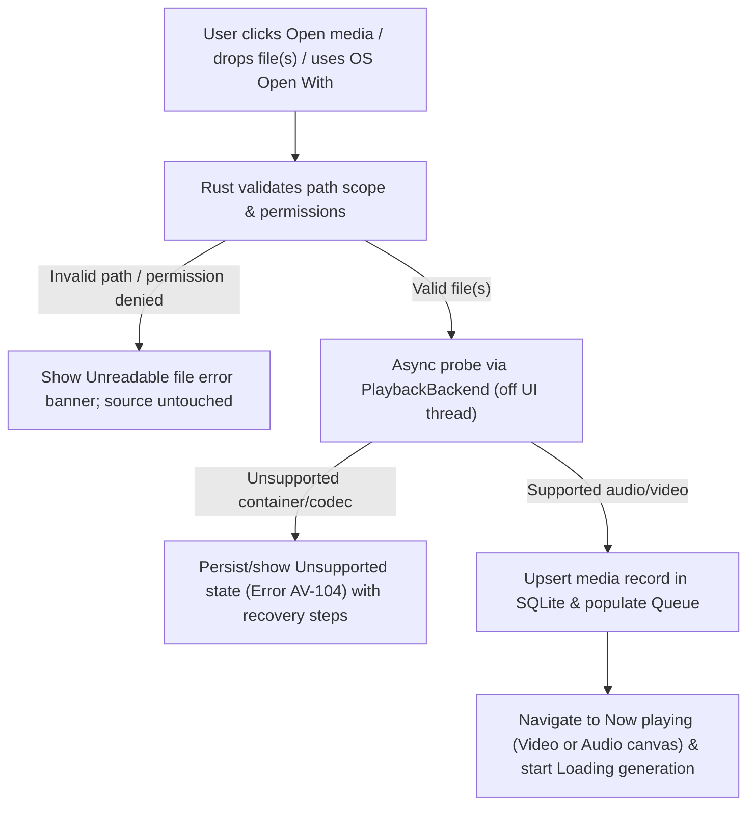
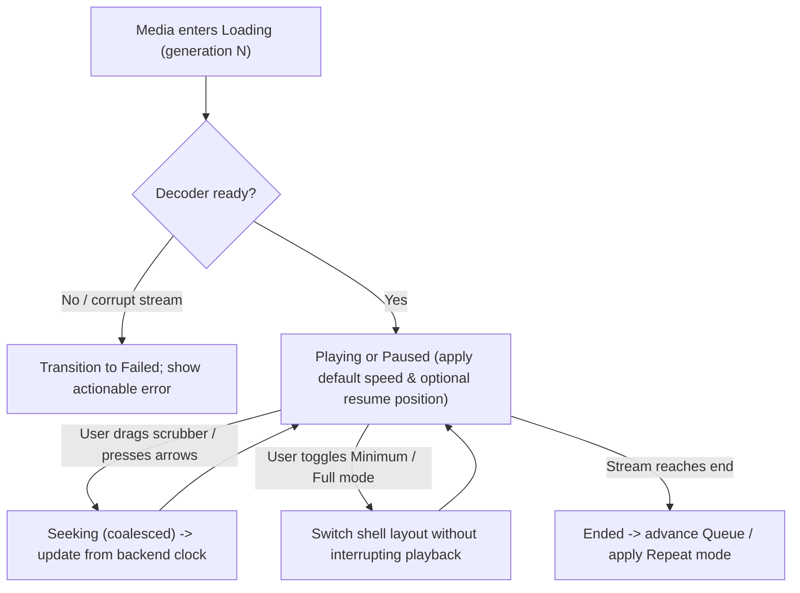
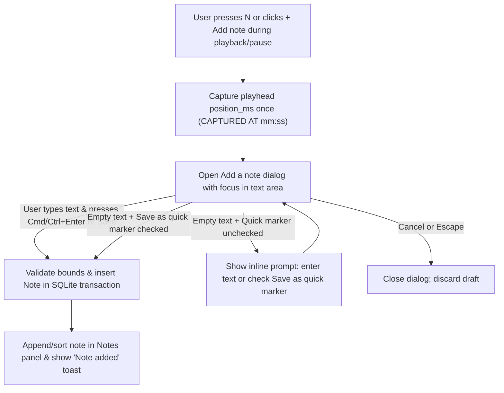
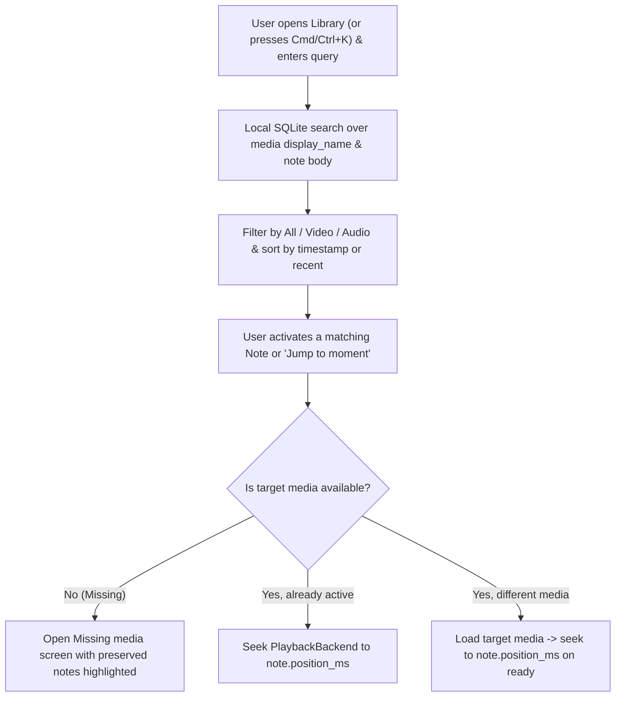
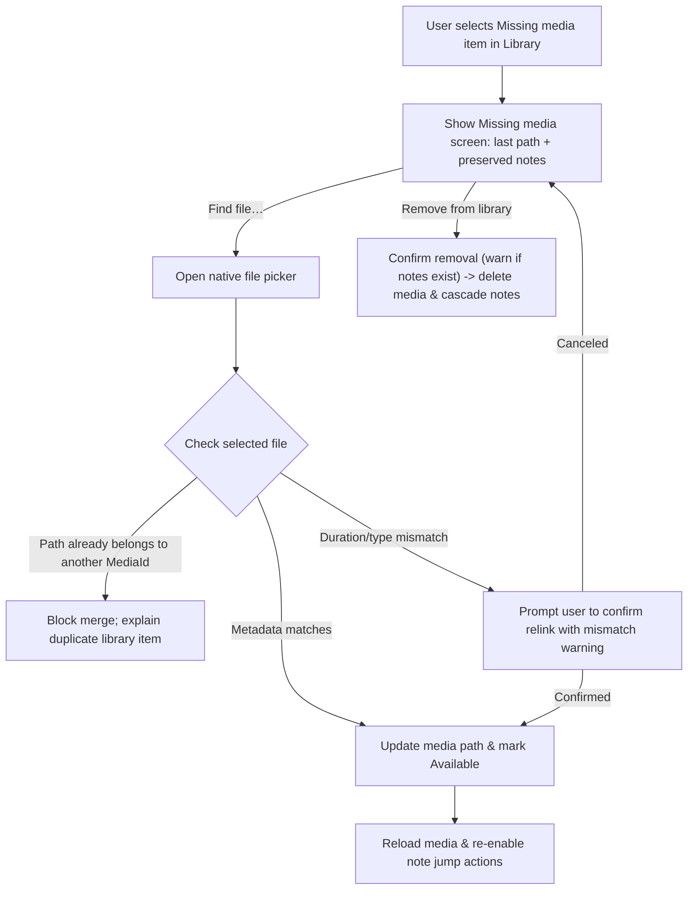

# User workflows and glossary

This document completes the Sprint 0.1 baseline for [PRODUCT.md](PRODUCT.md). It defines core product terminology, resolves edge-case behavior for timestamps, quick markers, search, and media relocation, and specifies the happy paths, failure paths, and acceptance criteria for Audora's primary user flows.

## Product glossary

| Term | Definition |
|---|---|
| **Media item** | A logical entry in the local Audora library (`MediaId`) representing a user-opened audio or video file, its probed metadata, playback progress, availability state, and associated notes. |
| **Media locator** | The normalized platform-specific filesystem path currently associated with a media item, paired with advisory file size and modification metadata (`MediaReference`). |
| **Availability** | The current reachability of a media item's source file: `Available`, `Missing` (file moved, renamed, or on an offline volume), `Unreadable` (permission or I/O error), or `Unsupported` (container/codec cannot be decoded). |
| **Full mode** | The primary application workspace containing the 56 px header, 76 px navigation rail (`Library`, `Now playing`, `Settings`), active main view, transport controls, and 365 px `Queue` / `Notes` side panel. |
| **Minimum mode** | A distraction-free compact/ambient playback view showing only play/pause, current time, duration, seek bar, and a quick control to return to Full mode. |
| **Load generation** | A monotonically increasing identifier assigned each time a media item is loaded so stale asynchronous decoder callbacks from a prior item are ignored. |
| **Playhead timestamp** | Media presentation time represented in persisted storage and IPC contracts as non-negative integer milliseconds (`position_ms`). |
| **Note** | A user-authored annotation (`NoteId`) attached to a `MediaId` and a fixed `position_ms`, containing plain-text `body` and creation/update timestamps. |
| **Quick marker** | A note saved with an empty body via explicit user choice (`Save as quick marker`) to bookmark a moment immediately without typing text; displayed with a distinct `Quick marker` label in lists and search. |
| **Session queue** | The ordered list of media items queued for playback in the current session, supporting explicit item selection, removal, repeat (`Off`, `All`, `One`), and shuffle. |
| **Relinking** | An explicit user-initiated action (`Find file…`) that updates a `Missing` media item's locator to a moved or renamed file while preserving all existing notes and playback history. |

---

## Resolved behavioral rules

### Timestamp capture, precision, and unknown duration
- **Single capture on trigger:** Triggering `Add note` (via `+ Add note` button or `N` shortcut) captures `position_ms` immediately when the action is invoked (`CAPTURED AT mm:ss`). Continuing playback or seeking while the dialog is open **MUST NOT** mutate the captured timestamp.
- **Storage vs. display precision:** All timestamps **MUST** be persisted as integer milliseconds (`0 <= position_ms`). The `Note timestamp precision` setting (`Nearest second` default, or `Milliseconds` `mm:ss.SSS` / `hh:mm:ss.SSS`) controls display formatting and whether newly captured timestamps round to the nearest second (`1000 ms`) or preserve exact millisecond position, clamped to `[0, duration_ms]` when `duration_ms` is known.
- **Unknown or unprobed duration:** If a playable stream reports unknown duration (`duration_ms = null`), notes capture the current presentation clock (`position_ms >= 0`) without an upper clamp. Seeking to a note whose timestamp exceeds actual stream end transitions cleanly to `Ended` or reports an out-of-range seek notice without deleting or altering the note.

### Quick markers vs. text notes
- Submitting the `Add a note` dialog with non-whitespace text saves a standard note (`body` trimmed of trailing line noise, bounded to a documented maximum length such as `10,000` UTF-8 characters).
- Submitting with empty/whitespace-only text is rejected with inline validation **unless** `Save as quick marker` is checked (or triggered via a dedicated quick-marker action).
- Quick markers store `body = ""` (or an explicit marker flag) and render a styled `Quick marker` placeholder label in the Notes panel, Missing Media view, and search results until edited.

### Playback progress and resume
- Audora persists `last_position_ms` on the `media` record periodically (debounced, e.g., every few seconds during playback, on pause, on item switch, and on shutdown).
- Library progress percentage is derived from `last_position_ms / duration_ms` (`Not started` when `last_position_ms == 0`; `Completed` / `100%` when playback reaches `Ended`).
- When `Resume where I left off` is enabled in Settings (default: **On**), opening a previously played item from the Library seeks to `last_position_ms` (unless it previously reached `Ended`, in which case it starts from `00:00`). Activating a specific note always seeks to the note's `position_ms`, overriding resume position.

### Media relocation and relinking ambiguity
- Missing files transition the library item to `Missing` (`MEDIA OFFLINE`) on open or explicit refresh; notes and `duration_ms` remain intact.
- When the user selects a replacement file via `Find file…`:
  1. **Already tracked path:** If the chosen path already belongs to another `MediaId` in the library, Audora **MUST** block silent merging and explain that the selected file is already in the library, allowing the user to cancel or choose another file.
  2. **Strong match:** Size and duration (within backend probe tolerance, e.g., `±500 ms`) match the prior metadata → relink updates `path`, `availability = Available`, and `last_seen_at`.
  3. **Ambiguous / mismatched metadata:** Duration or media type differs (for example, the new file is shorter than existing notes) → Audora **MUST** prompt the user showing old vs. new duration/type before updating the locator. Notes beyond the new duration are retained and flagged as out-of-range rather than deleted.

---

## Primary user flows

### Flow 1 — Open and import local media

- **Happy path:** User opens one or more files (or explicitly selects a folder). Audora probes metadata asynchronously, adds/updates library records without copying media bytes, populates the session queue, and loads the selected item.
- **Failure path:** Unreadable files report a permission/I/O error; unsupported codecs route to the `Unsupported media` screen (`Choose another file` / `Show in folder`) with a stable error code while keeping the rest of the app and queue responsive.
- **Acceptance criteria:**
  1. Opening media never blocks UI rendering or modifies source files (`mtime` and bytes remain unchanged).
  2. Dropping a folder requires explicit user intent and uses bounded non-symlink-loop traversal.
  3. Re-opening an existing path reuses its `MediaId` and existing notes.

### Flow 2 — Playback, seeking, speed, and window modes

- **Happy path:** User plays/pauses (`Space` or transport button), seeks via scrubber or skip buttons, adjusts volume/mute and playback speed (`0.5×`–`2.0×`), and switches seamlessly between **Full mode** (video canvas or audio artwork canvas + side panel) and **Minimum mode** without dropping audio/video frames.
- **Failure path:** Corrupt frames or disconnected external drives mid-playback transition playback to `Failed` (or `Missing` if the file disappeared), stop audio cleanly, and preserve previously saved notes and last committed progress.
- **Acceptance criteria:**
  1. Stale events from generation `N-1` cannot overwrite state in generation `N`.
  2. Displayed playhead reflects acknowledged backend presentation time.
  3. Switching between Full mode and Minimum mode preserves playback state, speed, and active queue.

### Flow 3 — Create a timestamped note or quick marker

- **Happy path:** User triggers note creation at `14:24`, captures `864000 ms` immediately, writes a note (or checks `Save as quick marker`), saves with `⌘/Ctrl+Enter`, sees `Note added` confirmation, and sees the note sorted chronologically in `Notes`.
- **Failure path:** Empty submission without `Save as quick marker` shows non-destructive validation; database write failure keeps the user's draft text open in the dialog with a retry/error message so no typed thought is lost.
- **Acceptance criteria:**
  1. Captured timestamp never drifts while the user is typing.
  2. Saved notes survive immediate process termination after confirmation toast appears.
  3. Note text is stored and rendered strictly as plain text (never interpreted as HTML).

### Flow 4 — Edit and delete notes

- **Happy path:** User opens the `⋯` menu on a note card in `Notes` → selects **Edit** to update `body` (`updated_at` refreshed, `position_ms` preserved) or **Delete** → confirms deletion (or triggers immediate delete with time-bounded `Undo` toast) → SQLite removes the record transactionally.
- **Failure path:** Canceling edit or delete leaves the note unchanged; failed persistence write leaves prior state intact and notifies the user.
- **Acceptance criteria:**
  1. Editing a quick marker by adding text converts it into a standard text note at the same `position_ms`.
  2. Deleting a note requires confirmation or provides an immediate `Undo` action before permanent removal.

### Flow 5 — Search library/notes and jump back to a moment

- **Happy path:** User searches offline across media titles and note bodies, filters by `All`, `Video`, or `Audio`, clicks a note or `Jump to moment` (`▶ 03:42`), and Audora loads (if needed) and seeks directly to `03:42`.
- **Failure path:** If the note belongs to an offline file, Audora navigates to the `Missing media` recovery view rather than failing silently; if a seek fails on a damaged file, the error is shown and the note remains untouched.
- **Acceptance criteria:**
  1. Search executes locally with zero network requests and parameterized SQL queries.
  2. Activating a note from either the `Notes` panel or search results lands on `note.position_ms` regardless of the global `Resume where I left off` toggle.

### Flow 6 — Missing media recovery and relinking

- **Happy path:** User sees `We can't find this file` alongside `Last known location` and the read-only `Your notes are preserved` list, clicks `Find file…`, selects the relocated file, confirms if needed, and immediately regains playback and note-jump capability.
- **Failure path:** Selecting an unreadable/unsupported file or a file already linked to another library entry is rejected safely without altering existing notes; `Remove from library` warns explicitly about deleting associated notes before executing.
- **Acceptance criteria:**
  1. Disconnected drives or moved files never auto-delete library entries or notes.
  2. Two distinct library records are never silently merged during relinking.
